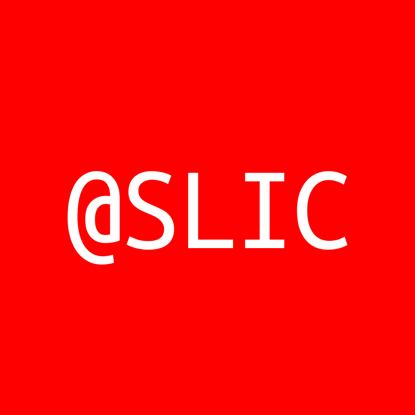
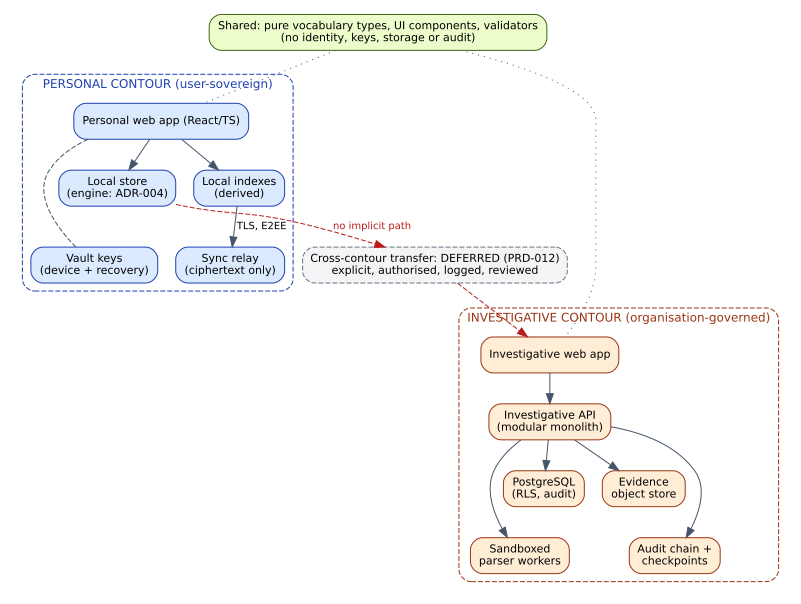
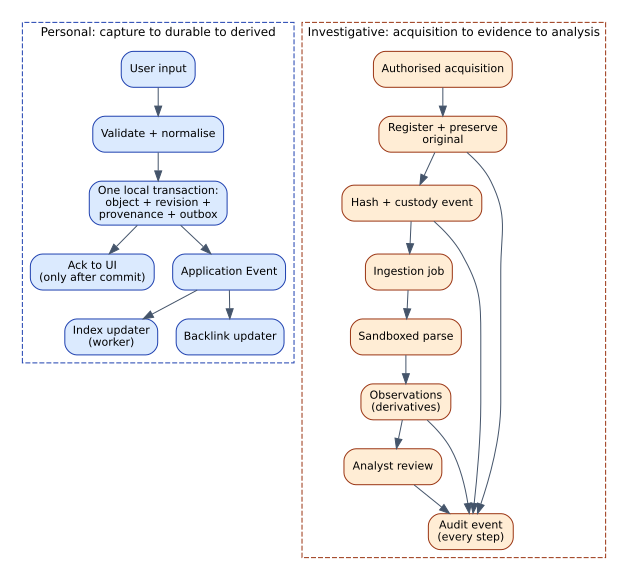

<p align="center">
  
</p>

<h1 align="center">SLIC</h1>

<p align="center"><strong>Knowledge with context. Sources in view.</strong></p>

<p align="center">
  <a href="docs/PRODUCT.md">Product</a> ·
  <a href="docs/README.md">Documentation</a> ·
  <a href="docs/DEVELOPMENT.md">Development</a> ·
  <a href="SECURITY.md">Security</a>
</p>

---

SLIC is being designed as a local-first workspace for structuring knowledge and examining evidence. It connects source material to observations, claims, entities, relationships, and change over time—while keeping the origin and status of information visible.

> **Project status** · SLIC is in its engineering-foundation stage. This repository contains the web/API starter and deployment foundation, not a finished knowledge-management product. The product capabilities below describe the documented direction and must not be read as shipped features.

## A product with two distinct contexts

The product plan defines two contours. They share vocabulary and engineering principles, but not data, identities, keys, or operating authority.

| Personal                                                           | Investigative                                                                |
| ------------------------------------------------------------------ | ---------------------------------------------------------------------------- |
| An individual builds and revisits a private body of knowledge.     | An authorised team works with governed cases and evidence.                   |
| Designed around local-first use and user control.                  | Designed around explicit access policy, custody, and audit.                  |
| The server, when used, is planned as an optional ciphertext relay. | The service is planned to enforce case access and preserve evidence history. |
| The first proposed user-facing release is scoped here.             | A separate technical foundation and release gate are required.               |



The boundary is a product invariant, not just a deployment preference: no implicit transfer is planned between the contours. The diagram is a target design, not a description of capabilities already running in this repository.

## How SLIC is intended to work

A user captures information, preserves its source, records what was observed, and then develops claims or links that can be revisited against their evidence. New interpretations should not overwrite the history that led to them.



The workflow is deliberately human-centred. A stored source or a hash does not prove that a statement is true; relationships do not prove causation; and AI output, if introduced, is intended to remain a proposal until reviewed.

## Product principles

- **Keep provenance attached.** Make it possible to ask where an observation or claim came from.
- **Preserve uncertainty.** Source, observation, claim, hypothesis, and decision are different kinds of records.
- **Respect time.** Record change and distinguish when something was true from when the system learned or recorded it.
- **Make knowledge portable.** Export, backup, and restore are core product concerns in the plan, not afterthoughts.
- **Separate contexts by design.** Personal and Investigative data must not mix implicitly.
- **Treat automation as assistance.** Suggested or derived content must be reviewable and must not silently become verified fact.

## What exists today

| In this repository                                                        | Product direction, not yet implemented here                                                              |
| ------------------------------------------------------------------------- | -------------------------------------------------------------------------------------------------------- |
| React 19 + Vite web application; NestJS API; shared Zod contracts.        | Personal capture, notes, typed entities, provenance, local persistence, and knowledge navigation.        |
| API status route and web/API integration.                                 | A separate Investigative workflow for cases, evidence custody, and governed access.                      |
| Optional PostgreSQL Compose service and production deployment foundation. | Encrypted sync, AI-assisted proposals, advanced graph views, and other independently gated capabilities. |

The current API does not use the optional PostgreSQL service. The app does not yet provide the planned local knowledge store, user authentication, sync, or AI workflows. See the [product overview](docs/PRODUCT.md) for the intended scope and the [engineering plan](docs/markdown/01_Engineering_Master_Plan.md) for stage and release boundaries.

## Explore the project

| If you want to…                                        | Start here                                                                         |
| ------------------------------------------------------ | ---------------------------------------------------------------------------------- |
| Understand the product, users, concepts, and non-goals | [Product overview](docs/PRODUCT.md)                                                |
| Find the full documentation set                        | [Documentation portal](docs/README.md)                                             |
| Run the current code and contribute                    | [Development guide](docs/DEVELOPMENT.md)                                           |
| Understand the proposed system structure               | [System architecture](docs/markdown/03_System_Architecture.md)                     |
| Review stages, dependencies, and release gates         | [Engineering master plan](docs/markdown/01_Engineering_Master_Plan.md)             |
| Inspect decisions, risks, and source limitations       | [Appendices and source register](docs/README.md#decisions-evidence-and-appendices) |

## Run the current foundation

Requirements: Node.js 22.12+, pnpm 12+ (the repository pins pnpm 12.21.0). Docker is optional unless you need local PostgreSQL.

```sh
corepack enable
pnpm install
```

Copy `.env.example` to `.env`, then run:

```sh
pnpm dev
```

The web app runs at <http://localhost:5173>, the API at <http://localhost:3000>. Visit `/status` in the web app to check its API connection. For tests, package commands, deployment setup, and troubleshooting, use the [development guide](docs/DEVELOPMENT.md).

## A note on claims

SLIC is not presented as a system that establishes truth, causation, guilt, or legal admissibility. Hashes can help detect changes but do not establish truth or lawful acquisition; append-only records do not by themselves guarantee immutability. Security and performance statements require evidence and review. See [security and data integrity](docs/markdown/11_Security_and_Data_Integrity.md) and the [source register](docs/Source_Register.md).
