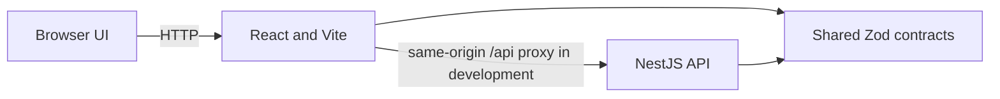

# Development Handbook

This guide describes the code that is in this repository today. The product vision and proposed capabilities are in the [Product Overview](PRODUCT.md); the detailed future-state architecture is in the [engineering blueprint](README.md#engineering-blueprint). Keep those plans separate from implementation claims.

[Project home](../README.md) · [Product](PRODUCT.md) · [Documentation portal](README.md)

> **Current foundation:** React/Vite web app + NestJS API + shared Zod contracts. The current API does not use PostgreSQL; the local database container is optional.

## Start locally

### Prerequisites

- Node.js 22.12 or later (`.nvmrc`)
- pnpm 12 or later (the repository pins pnpm 12.21.0)
- Docker only if you want to run the optional local PostgreSQL service

### Install and run

```sh
corepack enable
pnpm install
```

Create `.env` from `.env.example` and keep local values only. In PowerShell, use `Copy-Item .env.example .env`; in a POSIX shell, use `cp .env.example .env`.

```sh
pnpm dev
```

Open <http://localhost:5173>. The API runs on port `3000`; the web app's `/status` route checks the API through the `/api` proxy.

PostgreSQL is optional for the current app:

```sh
pnpm infra:up
# When finished
pnpm infra:down
```

Local Compose starts PostgreSQL only. Vite and NestJS run on the host; there is no local Caddy or nginx container in this workflow.

## How the current apps connect



The same-origin proxy is a development convenience. In production, Caddy routes `/api/*` to the API container and other requests to the static web container. This diagram describes the current starter integration—not the future Personal/Investigative product architecture.

## Workspace map

| Path | Responsibility | Current technologies |
| --- | --- | --- |
| `apps/web` | Browser UI and routes | React 19, Vite, TanStack Router/Query, TypeScript |
| `apps/api` | HTTP API | NestJS, Terminus health checks, Helmet |
| `packages/shared` | Contracts consumed by both apps | Zod schemas and TypeScript types; no app framework imports |
| `infra/` | Reverse proxy and server scripts | Caddy, shell scripts |
| `.github/workflows/` | Verification, release, deployment | GitHub Actions |

## Make a change safely

1. **Choose the owner.** Keep UI and route code in `apps/web`, API behavior in `apps/api`, and cross-app request/response schemas in `packages/shared`.
2. **Preserve boundaries.** Web must not import the API app; API must not import the web app; shared code must remain framework-independent and free of runtime I/O.
3. **Update contracts together.** When an API response changes, update its shared schema, server implementation, web consumer, and tests in the same change.
4. **Test at the right level.** Run a package-specific test first, then the complete repository check before a pull request.
5. **Update the docs.** Document actual behavior in the app README or this handbook. Update product/architecture docs only when their planned behavior, decision status, or evidence changes.

The import boundaries are enforced by lint rules. A boundary violation should be resolved by moving genuinely shared, pure code to `packages/shared`—not by adding an app-to-app dependency.

## Commands

Run from the repository root:

| Command | Use |
| --- | --- |
| `pnpm dev` | Run workspace development tasks in parallel |
| `pnpm --filter @repo/web test` | Run web unit tests |
| `pnpm --filter @repo/api test` | Run API unit tests |
| `pnpm --filter @repo/api test:e2e` | Run API end-to-end tests |
| `pnpm --filter @repo/web build` | Build the web app |
| `pnpm --filter @repo/api build` | Build the API |
| `pnpm lint` | Run lint and import-boundary rules |
| `pnpm check` | Format check, lint, typecheck, unit/E2E tests, and builds |

`pnpm check` is the recommended pre-PR verification command. It does not exercise the production Docker host or prove browser, TLS, backup, or rollback behavior.

## Troubleshooting

| Symptom | What to check |
| --- | --- |
| `pnpm` is not available | Confirm Node.js meets `.nvmrc` and `engines`, run `corepack enable`, and check the active pnpm version against the root `packageManager` field. |
| `/status` cannot reach the API | Confirm the NestJS process is running on port `3000`; inspect API startup/configuration errors; check the browser network request to `/api/v1/status` and Vite's `/api` proxy. PostgreSQL is not required for this endpoint. |
| Port `3000` or `5173` is occupied | Stop the process using the port. If changing a local port, ensure the Vite proxy target still matches the API port. |
| A schema change breaks the web app or API | Update the schema/type and both app call sites, then run both package test suites and typechecks. Avoid duplicating the contract in an app. |
| Lint reports an app-to-app import | Move only framework-independent shared contracts or utilities into `packages/shared`; keep app behavior inside its owning app. |
| PostgreSQL does not start | Confirm Docker is running, inspect `docker compose logs`, and check that the configured database port is free. The current API can run without this optional service. |
| CI fails although local tests pass | Compare Node/pnpm versions, install with `pnpm install --frozen-lockfile`, and inspect the first failing CI step. Avoid unrelated dependency changes as a workaround. |
| Production deploy or health check fails | Inspect GitHub Actions and `docker compose -f docker-compose.prod.yml logs`; verify server `.env`, image tag, DNS/TLS, and deployment secrets. Use the release/rollback workflow rather than patching a live container manually. |

Do not include secrets, user content, notes, or production data in logs or local test fixtures while diagnosing a problem.

## Tests and readiness

Before opening a pull request:

```sh
pnpm check
```

For deployment or infrastructure changes, also review [Infrastructure and DevOps](markdown/04_Infrastructure_and_DevOps.md), inspect the relevant `infra/` scripts, and exercise the change in a production-like environment. `pnpm check` does not validate TLS issuance, SSH deployment, browser Content Security Policy behavior, PostgreSQL backup restoration, or automatic rollback.

## Documentation and diagrams

- The [Product Overview](PRODUCT.md) describes intended user value, model, scope, and non-claims.
- The [engineering blueprint](README.md) contains proposed architecture, requirements, risks, and release gates. Labels `@R@` and `@OD@` indicate proposal and open decision—not shipped behavior or an accepted technology.
- Graphviz sources are in `diagrams/dot/`; corresponding rendered assets are in `diagrams/rendered/`. Update both source and render when changing a diagram.
- Use relative links, descriptive image alt text, and headings that make long documents easy to scan.
- Do not claim a POC, benchmark, security review, certification, performance target, or production drill is complete without recorded evidence.

## Deployment reference

The production Compose stack is separate from local development: Caddy is the HTTPS edge, the web image serves static assets, the API serves `/api/*`, and PostgreSQL is private to the API network. Deployment setup, CI gates, operational commands, and the backup/rollback notes are in the root [README](../README.md) and [Infrastructure and DevOps plan](markdown/04_Infrastructure_and_DevOps.md).
