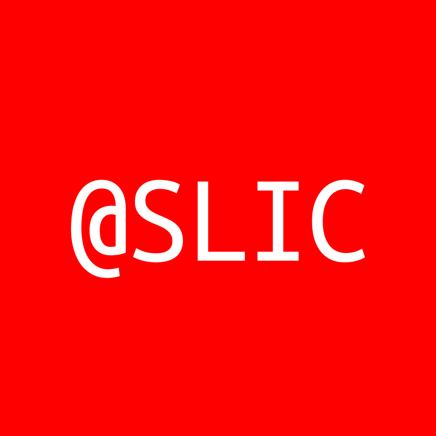
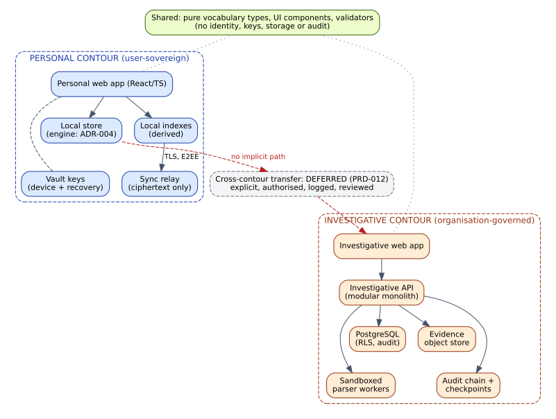
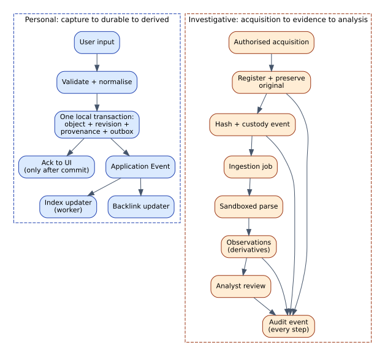

  

# SLIC — Product Overview

> **Knowledge with context. Evidence without guesswork.**

SLIC is a product concept and engineering programme for working with connected knowledge and evidence. It is designed to help people capture material, preserve its origin, distinguish observation from interpretation, and revisit how conclusions change over time.

This page explains the product direction in plain language. It is not a feature-completion statement: the current repository is an early web/API foundation, and the capabilities below are planned unless specifically identified as implemented.

[Back to project home](../README.md) · [Documentation portal](README.md) · [Developer guide](DEVELOPMENT.md)

## The problem SLIC is designed to address

Notes, files, links, and case material tend to accumulate faster than their context. Later, it can be difficult to answer basic questions:

- Where did this statement come from?
- Is this a direct observation, someone else's assertion, or my interpretation?
- What changed since the last time this was reviewed?
- Which records support or contradict this claim?
- Can another person understand how this conclusion was reached?

SLIC's proposed answer is to make provenance, relationships, revisions, and uncertainty part of the information model—not metadata that users have to reconstruct later.

## Who it is for

The research plan describes two distinct working contexts. They are separate product and security domains, not user roles inside one shared workspace.

### Personal contour

For an individual who wants to collect and connect information over time, maintain a private knowledge base, and retain the context behind their own notes and conclusions. The plan prioritises local-first operation and user control. A relay, if added, is intended to receive ciphertext rather than become the user's primary knowledge store.

### Investigative contour

For an organisation conducting governed investigative work. The plan includes case-scoped access, explicit responsibilities, evidence custody, controlled ingestion, and auditable actions. It is a separate technical track; it is not the first Personal release with a different label.

> **Boundary rule:** common terminology does not mean shared records, accounts, keys, storage, or processing. Any future transfer between contours must be explicit and reviewed; it is not an automatic product workflow.

## The knowledge model

SLIC's model avoids treating every piece of information as an interchangeable “fact.” The planned concepts have different meanings and roles:

| Concept | Meaning in the product model |
| --- | --- |
| **Capture** | An unprocessed item collected for later review. It preserves the initial input rather than requiring classification at capture time. |
| **Source** | A document, URL, file, note revision, or other material from which information may be derived. A preserved source is distinct from what someone says it means. |
| **Observation** | A record of what was noticed in a source, ideally with a locator that points back to the relevant passage or region. |
| **Claim** | A statement that can be related to supporting or contradicting observations. Its evidence and review status should remain visible. |
| **Entity** | A stable identity for a person, organisation, place, asset, or other domain object. Aliases and identifiers can point to the same entity without erasing their source. |
| **Relation** | A typed connection between records. A link represents a declared relationship; graph proximity alone is not proof of causation. |
| **Revision / activity** | A record of how content or process changed, helping preserve history and provenance. |
| **Collection** | A grouping and navigation aid. Membership is not itself a claim about the meaning of its members. |

The distinction between *kind* and *status* matters. For example, “claim” describes what an object is, while “supported,” “disputed,” or “reviewed” describes an assessment or review dimension. AI-generated content, if added, is planned to enter as a proposal and require human review before it can affect canonical records.

See [Domain and Data Architecture](markdown/06_Domain_and_Data_Architecture.md), the [data dictionary](appendices/B_Domain_Data_Dictionary.md), and the [glossary](appendices/G_Glossary_and_Terminology.md) for the detailed model.

## A typical knowledge journey

The proposed Personal journey begins with low-friction capture and gradually adds structure without losing the original context:

1. **Capture** a note, link, or file into an inbox.
2. **Preserve** the source and relevant metadata.
3. **Record an observation** with a locator to the source where possible.
4. **Form or revise a claim** and connect it to the observations that support or challenge it.
5. **Connect records** with typed relations and collections.
6. **Search and revisit** the material, history, and evidence behind a conclusion.
7. **Export or restore** the user's data using a documented, verifiable process.

In the Investigative track, authorised acquisition, preservation of originals, custody events, and controlled analysis are planned as separate governed workflows.

The figure is a target design from the engineering plan, not a sequence currently implemented in the application.

## Product principles

### Provenance is part of the record

A source, the observation made from it, and the claim someone draws from it should be separately represented and linkable. Where provenance is missing, the product should make that gap visible rather than inventing it.

### History should be understandable

Revisions and activity should help explain how a record came to its current form. A later correction should not silently erase the earlier context that matters to review.

### Uncertainty is useful information

SLIC is intended to support disagreement, missing evidence, and changing assessments. It should not collapse these into a single confidence number or label that hides their meaning.

### Local-first means user control, not “no risk”

The Personal direction prioritises local operation and user-controlled data. Browser storage can still be lost, compromised, or unavailable; backup, restore, export, and storage-health communication therefore remain essential design concerns.

### Separation must be enforceable

Personal and Investigative contexts have different trust models and must not share credentials, keys, data stores, or processing implicitly. Shared code, where appropriate, is limited to pure vocabulary and validation—not shared authority over private or case data.

### Automation must remain accountable

Search, derived indexes, parsers, and AI assistance can help users navigate material, but derived output must be distinguishable from canonical records. Automation should be reviewable, reversible where appropriate, and never presented as proof by itself.

## What is in scope—and what is not

The roadmap proposes a first Personal release centred on capture, notes, typed entities, relationships, provenance, local persistence, lexical search, accessible navigation, attachments, and data portability. The Investigative foundation, encrypted sync, and AI each have separate prerequisites and release gates.

| Planned for the first Personal release (roadmap) | Deferred or separately gated (roadmap) |
| --- | --- |
| Capture, notes and revisions | Encrypted multi-device sync and encrypted backup |
| Typed entities and bidirectional relations | AI-generated proposals |
| Sources, observations and manually authored claims | Visual graph and timeline interfaces |
| Local persistence and lexical search | Collaboration, semantic search, and advanced automation |
| Accessible basic navigation | Investigative user-facing workflows |
| Attachments, export, import, backup and restore | Forensic certification or legal-admissibility claims |

The full proposed release boundary is in [Release Engineering](markdown/17_Release_Engineering.md); stage dependencies and gates are in the [Engineering Master Plan](markdown/01_Engineering_Master_Plan.md). These are planning documents, not a promise that the scope is approved or delivered.

## What SLIC does not claim

SLIC is not intended to:

- turn a hash into proof that information is true, authentic, or lawfully obtained;
- infer that a relationship or graph path proves causation;
- automatically establish guilt, intent, or a person's identity;
- promise absolute immutability, zero metadata leakage, or a universal key-recovery mechanism;
- claim forensic certification or legal admissibility without applicable independent review;
- treat generated text as a verified fact without a review process.

These boundaries are important product requirements, not merely legal footnotes. See [Security and Data Integrity](markdown/11_Security_and_Data_Integrity.md) and the [Source Register](Source_Register.md) for the evidence and terminology rationale.

## Current implementation status

The codebase currently contains a React/Vite web app, a NestJS API, shared schemas and types, and the web/API status integration. PostgreSQL can be started locally, but the current API does not use it. The repository also has a production Compose/deployment foundation.

The planned knowledge model, local-first persistence engine, Personal product journeys, user authentication, sync, AI workflows, and Investigative contour are **not implemented as product capabilities in this repository**. The development status and how to run the existing foundation are documented in [Development](DEVELOPMENT.md); the roadmap's decisions and evidence labels are introduced in the [Documentation Portal](README.md).

## Further reading

- [System Architecture](markdown/03_System_Architecture.md) — proposed components, system context, trust boundaries, and flows.
- [Core Product Implementation](markdown/09_Core_Product_Implementation.md) — planned feature-level behavior and acceptance criteria.
- [Knowledge Navigation](markdown/10_Knowledge_Navigation.md) — planned search and navigation model.
- [Security and Data Integrity](markdown/11_Security_and_Data_Integrity.md) — threat assumptions, privacy, and integrity controls.
- [Open Questions and Risk Register](appendices/H_Open_Questions_and_Risk_Register.md) — decisions that still need owners or evidence.
- [Source Register](Source_Register.md) — research provenance, limitations, and interpretation choices.
