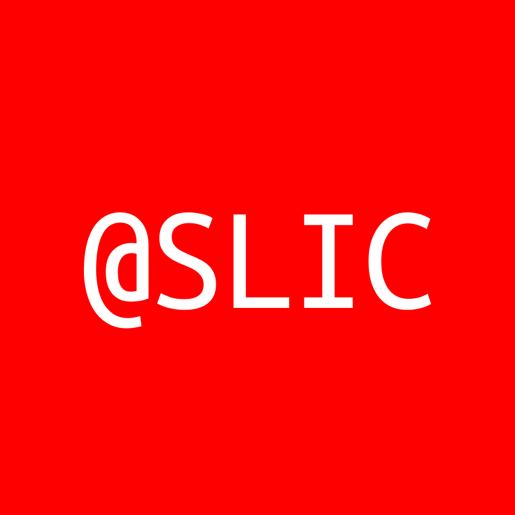
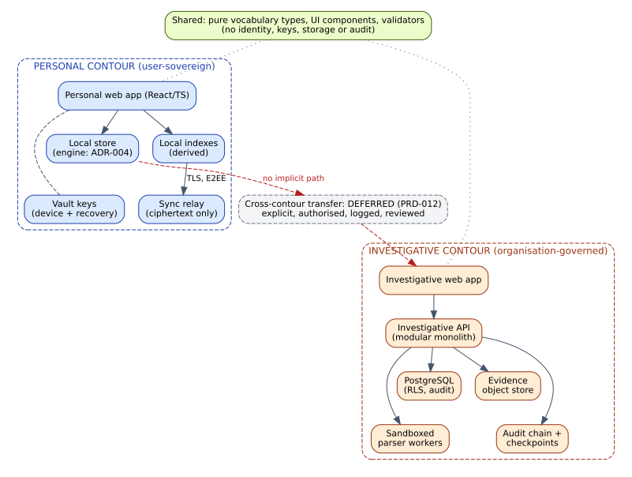

  

# SLIC Documentation

<strong>Product direction, engineering plan, and the code that exists today.</strong>

SLIC is being designed as a local-first knowledge and evidence workspace. This portal connects the product overview to the development handbook and the detailed engineering blueprint.

> **Read this first:** the product and architecture documents describe a proposed destination. The repository currently contains the web/API foundation; the planned knowledge workflows, local storage engine, sync, AI, and Investigative product are not yet implemented here.

## Choose your path

| I want to… | Read |
| --- | --- |
| Understand what SLIC is, who it is for, and what it is not | [Product overview](PRODUCT.md) |
| Run the repository or contribute a code change | [Development handbook](DEVELOPMENT.md) |
| Understand product journeys and concepts | [Product overview](PRODUCT.md#the-knowledge-model) |
| See the proposed system boundaries | [System architecture](markdown/03_System_Architecture.md) |
| Follow the delivery sequence and release gates | [Engineering master plan](markdown/01_Engineering_Master_Plan.md) |
| Review open decisions, risks, and research provenance | [Decisions, evidence, and appendices](#decisions-evidence-and-appendices) |

## Product at a glance

SLIC's planned knowledge model keeps source material, observations, claims, entities, relationships, and revisions distinguishable. It is designed to preserve the path from material to interpretation rather than flattening everything into an unqualified “fact.”

The product plan defines two separated contexts:

| Personal | Investigative |
| --- | --- |
| Individual, user-controlled knowledge work; local-first is the target. | Organisation-governed case work; access, custody, and audit are explicit. |
| Local records are intended to remain usable without a service. | Authorisation is enforced by the service, not trusted to the client. |
| Any future relay is planned for ciphertext and limited metadata. | Evidence originals and derived analysis have distinct handling. |

These are architectural targets, not running product features. The full product narrative and non-claims are in the [Product Overview](PRODUCT.md).

## Development at a glance

The current repository is a pnpm/Turborepo TypeScript workspace:

- `apps/web` — React 19, Vite, TanStack Router/Query.
- `apps/api` — NestJS API and health/status endpoints.
- `packages/shared` — shared schemas and types.
- `infra/` — Caddy and deployment scripts.

For setup, tests, boundaries, CI, and common failure resolution, use the [Development Handbook](DEVELOPMENT.md). It documents the code in this repository rather than the future product architecture.

## Engineering blueprint

The detailed plan is organised by subject. Its numbered order is for reading; the actual delivery sequence and dependencies are in document 01.

| # | Document | What it covers |
| --- | --- | --- |
| 00 | [Documentation Guide](markdown/00_README_and_Documentation_Guide.md) | Reading order, evidence labels, limitations, docs-as-code rules |
| 01 | [Engineering Master Plan](markdown/01_Engineering_Master_Plan.md) | Stages, dependencies, gates, critical path |
| 02 | [Engineering Foundation](markdown/02_Engineering_Foundation.md) | Requirements and architecture decision process |
| 03 | [System Architecture](markdown/03_System_Architecture.md) | Product contours, components, data flows, trust boundaries |
| 04 | [Infrastructure and DevOps](markdown/04_Infrastructure_and_DevOps.md) | Repository, environments, CI/CD, deployment foundations |
| 05 | [Technical Validation and POCs](markdown/05_Technical_Validation_and_POCs.md) | Experiments for unresolved technical risks |
| 06 | [Domain and Data Architecture](markdown/06_Domain_and_Data_Architecture.md) | Knowledge model, provenance, temporal data, invariants |
| 07 | [Application Architecture](markdown/07_Application_Architecture.md) | Application layers, services, state, accessibility |
| 08 | [Local Storage Engine](markdown/08_Local_Storage_Engine.md) | Proposed Personal persistence subsystem |
| 09 | [Core Product Implementation](markdown/09_Core_Product_Implementation.md) | Planned capture, notes, sources, entities, and relations |
| 10 | [Knowledge Navigation](markdown/10_Knowledge_Navigation.md) | Search, graph navigation, and discovery |
| 11 | [Security and Data Integrity](markdown/11_Security_and_Data_Integrity.md) | Threats, privacy, crypto review, integrity controls |
| 12 | [Import and Export](markdown/12_Import_and_Export_Architecture.md) | Portability, backup, and restore |
| 13 | [AI Engineering](markdown/13_AI_Engineering.md) | Gated, review-based AI assistance |
| 14 | [Synchronization Engineering](markdown/14_Synchronization_Engineering.md) | Candidate encrypted multi-device sync |
| 15 | [Investigative Contour Foundation](markdown/15_Investigative_Contour_Foundation.md) | Case access, evidence, custody, audit |
| 16 | [Testing and Production Readiness](markdown/16_Testing_and_Production_Readiness.md) | Test strategy and readiness gates |
| 17 | [Release Engineering](markdown/17_Release_Engineering.md) | Proposed Personal v1.0 boundary and release process |

### Decisions, evidence, and appendices

- **Decisions:** [Architecture Decision Records](appendices/A_Architecture_Decision_Records.md) · [Open Questions and Risk Register](appendices/H_Open_Questions_and_Risk_Register.md)
- **Product model:** [Data Dictionary](appendices/B_Domain_Data_Dictionary.md) · [Glossary](appendices/G_Glossary_and_Terminology.md)
- **Contracts and assurance:** [API and Event Contracts](appendices/C_API_and_Event_Contracts.md) · [Threat Model](appendices/D_Threat_Model_and_Security_Matrix.md) · [Test Catalogue](appendices/E_Test_Catalogue_and_Acceptance_Matrix.md)
- **Operations:** [Infrastructure and Deployment Specification](appendices/F_Infrastructure_and_Deployment_Specification.md)
- **Research provenance:** [Source Register](Source_Register.md)

## Evidence labels and decision status

The engineering blueprint distinguishes what is known from what is proposed:

| Label | How to interpret it |
| --- | --- |
| `@SD@` | Derived from the supplied research pack. |
| `@V@` | Verified within the cited source or experiment scope; not automatically validated for SLIC. |
| `@R@` | Engineering recommendation; it may be changed when evidence or an owner decision requires it. |
| `@OD@` | Open decision; do not treat it as selected technology or approved behavior. |

A recommendation becomes a project decision only through the relevant review and ADR process. No POC, benchmark, security certification, or cryptographic review should be called complete without recorded evidence.

## Diagrams and source material

Diagrams are maintained as Graphviz sources in [`diagrams/dot/`](diagrams/dot/) and rendered assets in [`diagrams/rendered/`](diagrams/rendered/). Change both together and link to the rendered version from Markdown.

The [Source Register](Source_Register.md) records which research inputs were supplied, how inconsistencies were handled, and what remains unknown. The original PDFs are not checked into this repository. Several registers, acceptance catalogues, and field-level tables referenced by the research programme were not present in the supplied Markdown edition; each affected page now identifies that gap. Referenced IDs are not populated records or evidence that a gate passed.
