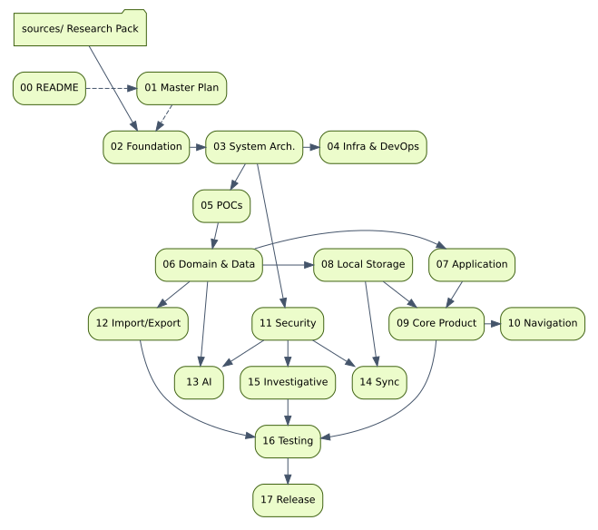
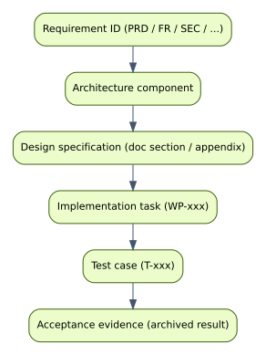

# 1. Purpose
This documentation set turns the **SLIC Engineering Research Pack v0.1** (13 November 2026) into an implementation-oriented engineering blueprint: 18 main documents, 8 appendices, and a source register. It is versioned alongside the code under `docs/` and is intended to be reviewed as a living plan.

It is **not** an approved production design, and it is not a description of features already shipped in the repository. No proof of concept is recorded as run, no benchmark as executed, and no cryptographic protocol as reviewed. Performance figures are targets to measure; technologies left open by the Research Pack remain recommendations or open decisions until evidence and an ADR resolve them. See the [repository documentation index](../README.md) for the current-code vs target-design distinction.

# 2. Scope
In scope: the engineering path from the current research state to **Personal Contour v1.0**, plus the **Investigative technical foundation**, plus clearly gated advanced capabilities (encrypted sync, AI assistance). Out of scope: market analysis, legal opinion, security certification, cost quotes, delivery dates (the team and capacity are unknown — OQ-16).

# 3. Statement labels used throughout
| Label | Meaning | Rule |
|---|---|---|
| @SD@ Source-derived | Present in the Research Pack | Cite the pack document and section |
| @V@ Verified | Confirmed against primary technical documentation, a standard, or a reproducible experiment | Listed with verification level in `sources/External_References.pdf`; "secondary" or "pack-cited" levels are shown explicitly |
| @R@ Recommendation | Engineering proposal of this programme | Rationale given; may be overturned by evidence |
| @OD@ Open Decision | Not enough evidence | Options, experiment, acceptance criteria and ADR slot provided |

**Verified does not mean "true for SLIC".** A verified statement about PostgreSQL or Web Crypto supports only the scope of that source; it never proves that a technology fits SLIC.

# 4. Package map
| ID | Document | Purpose | Stage |
|---|---|---|---|
| 00 | README & Documentation Guide | This guide, index, rules | — |
| 01 | Engineering Master Plan | Sequence, dependencies, gates, critical path | S0 |
| 02 | Engineering Foundation | Requirements catalogue, ADR system | S0 |
| 03 | System Architecture | Context, containers, components, boundaries | S0 |
| 04 | Infrastructure & DevOps | Repo, environments, CI/CD, topology, cost model structure | S0 |
| 05 | Technical Validation & POCs | Ten experiment protocols | S1 |
| 06 | Domain & Data Architecture | Canonical model, epistemics, time, provenance, schema | S2 |
| 07 | Application Architecture | Layers, services, state, design system | S2 |
| 08 | Local Storage Engine | Personal persistence subsystem | S3 |
| 09 | Core Product Implementation | Capture, notes, entities, sources, relations, collections | S3 |
| 10 | Knowledge Navigation | Search, graph, timeline, visualisation | S3 |
| 11 | Security & Data Integrity | Threat models, crypto architecture, privacy, integrity | S4 |
| 12 | Import & Export Architecture | Portability, backup, verified restore | S4 |
| 13 | AI Engineering | Controlled AI subsystem | S5 |
| 14 | Synchronization Engineering | Encrypted multi-device sync | S5 |
| 15 | Investigative Contour Foundation | Tenants, cases, evidence, audit | S6 |
| 16 | Testing & Production Readiness | Test strategy, gates, operations | S7 |
| 17 | Release Engineering | v1.0 definition and release process | S7 |
| A–H | Appendices | ADRs, data dictionary, contracts, threat matrix, tests, infrastructure, glossary, open questions/risks | — |
| Evidence | `docs/Source_Register.md`, `docs/appendices/External_References.md`, and the supplied research ZIP (not stored in this repository) | Source audit and references | — |

Numbering is a reading order, not an execution order. Execution order is in document 01.

# 5. Dependency map and reading order

Recommended reading: 00 → 01 → 02 → 03 → 05 → 06 → 08 → 09 → 11 → (12, 10) → 14/13 → 15 → 16 → 17. Security reviewers should read 03, 11, 14, 15 and Appendix D first; storage engineers 05, 06, 08, 12; QA 02, 16, Appendices E and H.

# 6. Traceability model

This figure shows the intended requirements → tests → work packages traceability chain. The generated requirement, test, and work-package rows and the QA report are not included in this repository edition, so coverage cannot currently be verified mechanically. Appendix E and the Source Register call out these missing records.

# 7. Rules for changing the documentation
1. **Docs-as-code.** Markdown sources live in `docs/markdown/` and `docs/appendices/`; Graphviz sources live in `docs/diagrams/dot/`, with rendered SVG/PNG assets in `docs/diagrams/rendered/`. Changes go through pull requests reviewed like code. @R@
2. **ADR discipline.** A change to a decision is a new ADR that supersedes the old; statuses follow Appendix A §2.
3. **Version numbers.** Package version `MAJOR.MINOR`: MAJOR when an Accepted ADR, an invariant or the release scope changes; MINOR for all other substantive edits. Each document carries its own date and the baseline it was derived from.
4. **Evidence updates.** When a POC runs, results are added to document 05 and the ADR's *Validation evidence* field; labels change from @OD@ to @V@/@R@ in the same change.
5. **Open decisions are never deleted** — they move to a closed section with the deciding ADR.
6. **Terminology** changes are made in Appendix G first.

# 7. Source materials
The supplied Research Pack ZIP contains eight PDFs; the ZIP and PDFs are not stored in this repository. The source programme also mentions two further artefacts — *LIVARA Group.pdf* and *SLIC-Research-and-Documentation-Checklist.pdf* — which were **not supplied** (OQ-18). Statements about their content are known only through the pack.

# 8. Limitations of this documentation
- No experiments are recorded as executed; the protocols in document 05 are proposals until reproducible results are added.
- The generated requirements, ADR, threat, test, acceptance, and risk-register tables are not included in this repository edition. Referenced IDs are not proof that a record exists or a gate passed.
- External references were checked selectively (see `docs/appendices/External_References.md`); remaining ones are carried from the pack and must be re-verified before they support a release decision.
- No decision owner, team, budget, jurisdiction or customer is known; decisions depending on them are @OD@.
- Dates are not given. Effort estimation criteria are in document 01 §10.
- Wording of invariants from the Research Pack is preserved; this package never promises: brain replication, absolute immutability, absolute zero-knowledge, legal admissibility, automatic establishment of guilt or intent, measured performance, a ready-made key-recovery system from WebAuthn, or a pre-selected CRDT/graph/vector engine.

# 9. Document index and deliverables
The deliverables present in this repository are the Markdown engineering documents and appendices, `docs/Source_Register.md`, and editable/rendered diagrams under `docs/diagrams/`. The original research PDFs, generated QA report, manifest, checksums, and PDF publication bundle are not present in this working tree. Use the source register and Appendix H for provenance, known gaps, and unresolved questions; do not treat absent generated artefacts as completed evidence.
