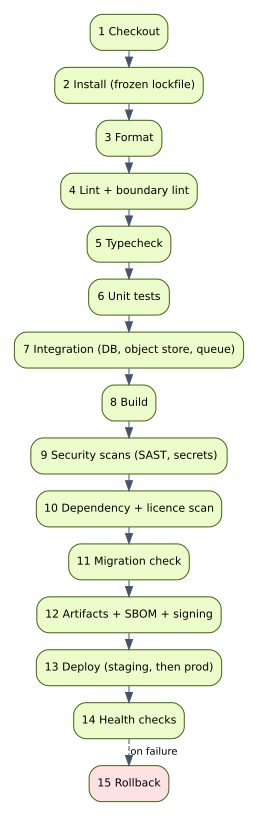

# 1. Purpose
Describe repository organisation, environments, CI/CD, infrastructure building blocks, operational foundations and an initial cost model *structure*. Deployment-level tables are in Appendix F.

# 2. Scope
Engineering infrastructure for both contours. Excludes organisational processes (staffing, procurement) and any provider-specific configuration.

# 3. Dependencies
Doc 03 (topology), doc 11 (secrets, supply chain), Research Pack 03§11, 06§7 @SD@. Open: ADR-012, ADR-022, OQ-02/03/15.

# 4. Requirements
OPS-001 (CI gates), OPS-002 (release/rollback), SEC-003 (supply chain), OPS-003/004 (Investigative backup drills, monitoring), PRV-002 (log hygiene), SEC-001 (no shared credentials/pipelines).

# 5. Design
## 5.1 Repository
Recommendation @R@ (ADR-012, Proposed): **one monorepo with machine-enforced package boundaries**, per-contour build and release pipelines, CODEOWNERS per area.

| Option | Pros | Cons | Verdict |
|---|---|---|---|
| Monorepo + boundary lint | Atomic changes across shared vocabulary; one toolchain; contract changes visible in one review | Larger blast radius for a compromised dependency; access control is per-path, not per-repo | Provisional lean |
| Separate repo for Investigative | Stronger access segregation; independent audit scope | Duplicated tooling; shared vocabulary needs publishing | Revisit if customers/auditors require it |
| Polyrepo per package | Maximal separation | High coordination cost for a small team | Rejected for now |

Proposed layout:
```
slic/
  apps/
    personal-web/            # React client (Personal)
    personal-relay/          # ciphertext relay (ADR-013)
    investigative-web/       # React client (Investigative)
    investigative-api/       # modular monolith
    investigative-worker/    # job runner (no app credentials)
    parser-sandbox/          # untrusted parsers, minimal image
  packages/
    shared/pure/             # vocabulary types, validators, UI kit (NO I/O)
    personal/                # domain-core, storage-ports, adapters, search, crypto
    investigative/           # domain modules, db schema/migrations, policies
    contracts/               # schemas -> types + validators (per contour)
    test-kit/                # fixtures, generators, benchmark harness
  infra/                     # IaC, compose files, runbooks
  docs/                      # these documents (Markdown + diagram sources)
```
Boundary rules (T-ISO-001): `personal/*` and `investigative/*` cannot import each other; only `shared/pure` is common; `contracts/` is split per contour so wire formats can diverge; `test-kit` is dev-only.

## 5.2 Environments
| Env | Purpose | Data | Secrets | Network / access |
|---|---|---|---|---|
| Local dev | Developer loop | Synthetic seed only | Dev-only, never reused | Localhost; Compose stack |
| CI | Build/test/scan | Synthetic | Ephemeral, scoped per job; no production secrets | Egress allow-list |
| Test | Shared integration | Synthetic | Test secrets | Team access |
| Staging | Production-like rehearsal | Synthetic or explicitly approved | Separate from prod; own IdP tenant | Restricted team access, prod-like network policy |
| Production — Personal | Relay + static hosting | Ciphertext only | Relay secrets | Public HTTPS; admin via controlled path |
| Production — Investigative | Governed case data | Customer data | KMS-managed, per-service identities | Private networking; controlled admin access; no standing plaintext access |
Full matrix (configuration, DB, storage, logging, monitoring) in Appendix F §3.

## 5.3 CI/CD

| # | Stage | Gate behaviour |
|---|---|---|
| 1–2 | Checkout; install with frozen lockfile | Fails on lockfile drift |
| 3–5 | Format; lint + boundary lint; typecheck | Boundary violation blocks (SEC-001) |
| 6–7 | Unit; integration (PostgreSQL, object-store emulator, queue; local DB adapters) | Required |
| 8 | Build (reproducible where feasible) | Artifacts hashed |
| 9–10 | SAST + secret scan; dependency + licence scan | Critical findings block unless waived with expiry |
| 11 | Migration check: apply on fixtures, verify counts/hashes, test interruption | Blocks on data change |
| 12 | Artifacts: SBOM, signing | Unsigned artifacts cannot deploy |
| 13–15 | Deploy to staging → prod; health checks; automatic rollback | Post-deploy verification must pass |
Separate pipelines per contour with separate credentials (T-OPS-001).

## 5.4 Infrastructure building blocks
| Component | Position | Notes |
|---|---|---|
| Containers (Docker) | Local dev and Investigative deployment unit @R@ | Parser sandbox image minimal, rootless, no network |
| PostgreSQL | Investigative system of record (ADR-003) | Pin a supported major version at implementation (official docs list 18 as current on 2026-11-14 @V@, level 1). Backups + PITR candidate |
| Object storage | Evidence/exports; relay ciphertext blobs | S3-compatible interface is a *candidate* only; versioning/retention/legal-hold features required for Investigative |
| Queue / background jobs | Ingestion jobs | Start with PostgreSQL-backed queue if workload permits @R@ (fewer moving parts); alternative requires evidence |
| Redis | **Not included** | Add only with a measured need (cache/queue) — Research Pack baseline lists no mandatory Redis |
| Reverse proxy + TLS | Edge | Modern TLS configuration, HSTS; COOP/COEP headers on the Personal origin only if the chosen SQLite VFS requires them (reported for the default OPFS VFS; verify in POC-02) |
| Secrets | KMS/secret manager | Per-service identities; rotation; no secrets in images or logs |
| Monitoring / logging | Per contour, separate sinks | Content-free logs; correlation IDs without content; logs are not an audit ledger @SD@ |
| Backup / DR | Separate failure domain | RPO/RTO to be set with the customer model (OQ-02/10); restore drills (OPS-003) |

## 5.5 Provider selection (ADR-022, Deferred)
Do not bind to a cloud provider until evaluated against: data residency (OQ-03); operator access model; encryption/key custody options; backup/restore capabilities and separate failure domains; object-lock/retention features; cost; exit portability; compliance attestations relevant to the customer model; availability of managed PostgreSQL with the required roles/RLS behaviour. Method: weighted matrix with a restore test as the tie-breaker.

## 5.6 Initial cost model (structure only)
No prices are asserted. The model is a spreadsheet with explicit inputs:
`Monthly cost = Σ compute(instances × hours × unit price) + DB(storage GB × price + IOPS/backup retention price) + Object(storage GB × price + requests + egress GB × price + retention/versioning overhead) + Queue/Workers + KMS(requests) + Monitoring(log GB × price) + Backup(GB × price) + Staging(≈ fraction of prod) + Licences/Support`.
Inputs needing data: user/tenant counts, case sizes, average evidence size, retention periods, replication/backup factor, parser CPU-seconds per MB (from POC-10), AI inference volume (if any). Assumptions are recorded next to each input; results are ranges.

# 6. Technology
Tooling @R@: pnpm workspaces or an equivalent workspace manager (decision at SG0); a task runner with caching; Vitest/Playwright-class test tools (candidates); OpenAPI/Zod contract generation (candidate); IaC tool chosen with provider (ADR-022); Docker Compose for local stack @SD@ (06§7).

# 7. Implementation
1. Create repository, CODEOWNERS, protected branches, PR template (ADR/requirement/test links). 2. CI skeleton with stages 1–6 and boundary lint (WP-007). 3. Local Compose stack with PostgreSQL, object-store emulator, queue, seeded synthetic data. 4. Add scanners, SBOM, signing. 5. Add migration check once WP-034 exists. 6. Provision staging only after threat-model baseline (WP-008) and deployment boundary checklist.

# 8. Data & Contracts
Configuration schema per environment (validated at start-up; secrets by reference); release manifest (artifact hash, SBOM hash, schema version); migration manifest (from/to version, checksums).

# 9. Security
Supply chain: lockfiles, pinned versions with a cooling period for brand-new releases @R@, dependency/secret scanning, SBOM, signed artifacts, least-privilege CI tokens, protected branches, reviewed workflow changes. Separate pipelines and credentials per contour. Admin access is time-boxed and audited.

# 10. Failure Handling
Failed deploy → automatic rollback to the previous signed artifact; incompatible migration → expand/contract so previous version still runs; CI outage → no manual deploy bypass without recorded exception; secret exposure → rotate, assess impact, runbook (doc 16 §5.8).

# 11. Testing
T-OPS-001 (pipeline blocks seeded failures), T-OPS-002 (rollback), T-ISO-003 (deployment boundary review), T-OPS-003/004 (Investigative drills).

# 12. Acceptance Criteria
SG0: CI skeleton green with boundary lint. SG7: signed artifacts, exercised rollback, restore drill (Investigative), no shared credentials between contours.

# 13. Deliverables
Repository with layout above; pipeline definitions; Compose stack; environment matrix; IaC (after ADR-022); cost model spreadsheet with assumptions.

# 14. Risks
RK-12 supply chain; RK-15 drift; operational burden of two pipelines (accepted trade-off for isolation).

# 15. Open Decisions
ADR-012 (repo split trigger), ADR-022 (provider, hosting), OQ-15 (licence), workspace tool choice, queue technology (PostgreSQL-backed vs dedicated) after POC-10 load data.

# 16. References
Research Pack 03§11, 06§7 @SD@; PostgreSQL documentation (versions page) @V@ level 1 (fetched 2026-11-14).
