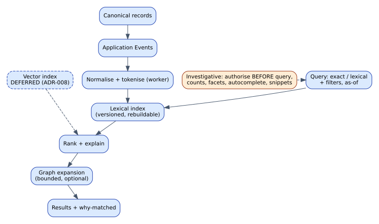

# 1. Purpose
Specify how users find and navigate knowledge: search mechanisms, graph navigation, timeline and visualisation, with an accessible alternative to every visual.

# 2. Scope
Personal Contour (v1.0: exact + lexical search, accessible graph lists; v1.x: visual graph, timeline UI, explanations; Later: semantic). Investigative search rules are stated where authorization changes the design.

# 3. Dependencies
Docs 06, 08; POC-03/04/06; Research Pack 03§8, 01§5–6 @SD@. Open: ADR-005, ADR-008, ADR-017, OQ-14.

# 4. Requirements
FR-SRCH-001 (P0), FR-SRCH-002 (P1), FR-SRCH-003 (P2), FR-NAV-001 (P0), FR-NAV-002 (P1), FR-TL-001 (P1), SEC-009 (Investigative authorization), A11Y-001. Source guidance @SD@: layered retrieval; RRF only after each retriever has independent quality metrics; explain why a result was returned; Investigative search enforces case-level permissions before returning snippets, counts, facets or autocomplete.

# 5. Design
## 5.1 Mechanisms and release scope
| Mechanism | Index / structure | v1.0? | Notes |
|---|---|---|---|
| Exact search | identifiers, aliases, titles, hashes (btree/lookup) | Yes | Deterministic |
| Lexical search | tokenised inverted index with ranking (BM25-style) | Yes | Engine per ADR-017 |
| Full-text (engine-native) | SQLite FTS-class or PostgreSQL FTS (Investigative) | If engine chosen supports it | Verify availability in POC-04 |
| Fuzzy search | edit-distance/n-gram over titles/aliases | v1.x (measure first) | Typos |
| Semantic/vector | local embeddings + ANN index | Later (ADR-008 Deferred) | Embeddings are sensitive derived data |
| Graph-based retrieval | bounded neighbourhood expansion of result set | v1.x | Never the only signal |
| Temporal filtering | tx/valid/event time filters | v1.0 for tx-time filters; as-of in v1.x | Uses bitemporal fields |
Hybrid fusion (RRF) is **not** introduced until POC-04 has scored each retriever independently @SD@.

## 5.2 Search pipeline

Index structure: per field (title, body, alias, observation text, claim text) with field weights; stores index version and normalisation version. Update strategy: event-driven incremental updates in a worker after commit; last-applied sequence persisted; full rebuild resumable. Query execution: parse → normalise (NFC, case folding, language-aware tokenisation per OQ-14) → retrieve → rank → apply filters → explain. Ranking: documented, deterministic scoring (BM25-style) with field boosts; ties by recency. Permissions: Personal = vault only; Investigative = tenant/case + role filter applied **before** query, counts, facets, autocomplete and snippets (SEC-009, T-SRCH-005). Rebuild: from canonical records only. Metrics: Recall@K, Precision@K, nDCG, latency, index size, build time (POC-04).

**Explanation.** Each hit carries `matched_fields`, `terms`, `via` (direct | alias | backlink | graph) — FR-SRCH-002.

**Privacy.** Local indexes contain plaintext tokens: protect like content. Server-side search over Personal data does not exist (a zero-knowledge relay cannot do semantic search over plaintext embeddings without a leakage trade-off @SD@).

## 5.3 Graph navigation
| Capability | Specification |
|---|---|
| Backlinks | Query incoming relations to an object, grouped by predicate class, paginated |
| Outgoing / incoming | Both directions with predicate labels and direction text ("A → owns → B") |
| Neighbourhood | Depth-limited expansion (default 1, max configurable ≤ declared limit), typed predicate filters, node cap, cursor pagination |
| High-degree nodes | Summarised with counts per predicate; user expands by predicate |
| Temporal | Filter by valid/tx time |
| Search integration | "Open neighbourhood of result", "restrict search to neighbourhood" |
| Large graphs | Query budgets; incremental load; never load all edges |
**Accessible navigation is the primary graph UI for v1.0 (FR-NAV-001):** lists/trees/tables with keyboard navigation, semantic labels (type, direction, predicate), live announcements for expansion, and focus management. Graph topology never implies causation @SD@ — analytical/causal predicates are labelled as such.

## 5.4 Timeline
Time axes @SD@: event time, recorded time, revision time, valid time. Views: chronological list with grouping (day/month/year), filters by type/collection, "as-of" reconstruction (what we knew on date D). Items with unknown/approximate time are shown in a separate "undated/approximate" group, never forced onto false precision. v1.x scope (FR-TL-001).

## 5.5 Visualisation
| Approach | Strengths | Weaknesses | Use |
|---|---|---|---|
| DOM/SVG | Accessible by default, easy interaction | Poor at large node counts | Small neighbourhoods; fallback |
| Canvas 2D | Better scale | Accessibility must be re-created | Medium graphs |
| WebGL (e.g. PixiJS, candidate @SD@) | Highest scale | Complexity, memory, accessibility via parallel DOM model | Dense graphs, after POC-06 |
| WebGPU | Potential performance | Limited availability, secure contexts only @SD@ | Not baseline |
Rules: layout calculation in workers; the visual graph is **never the only way** to understand relations (FR-NAV-002); the 50k nodes @ 60 FPS figure is a *benchmark target* measured by frame-time distributions, not an SLA; switch to aggregated/filtered views beyond measured visible-node limits; respect reduced-motion.

# 6. Technology
Lexical engine: ADR-017 candidates (library inverted index, SQLite FTS-class if SQLite chosen, custom). Graph rendering: POC-06 candidates. Intl APIs for segmentation/collation are candidates for language handling (@R@, availability per browser to verify in POC-04). PostgreSQL native full-text search for Investigative where policy permits @SD@ (03§6).

# 7. Implementation
1. Implement exact lookup indexes (WP-047 start). 2. Lexical index worker with versioned rebuild. 3. Query parser, ranking and explanations. 4. Backlinks/neighbourhood queries and list UI with a11y tests (WP-048). 5. Telemetry-free search performance probes in the benchmark harness. 6. Later: fuzzy, visual graph, timeline, evaluate vector.

# 8. Data & Contracts
`SearchQuery`, `NeighbourhoodQuery`, `AsOfQuery` in Appendix C. Search result record: `{object_ref, type, score, matched_fields[], via, snippet?}`; snippets are generated from authorised content only.

# 9. Security
Investigative: authorisation before search execution, counts, facets, autocomplete and error messages (uniform responses); embeddings/summaries are derived artefacts with source lineage and model/version @SD@. Personal: local-only; no search terms leave the device (PRV-002).

# 10. Failure Handling
Index missing/corrupt → rebuild with progress; search falls back to exact lookup/scan with notice; depth/limit violations → typed `DEPTH_LIMIT`; renderer failure → fall back to accessible lists.

# 11. Testing
T-SRCH-001…005, T-NAV-001/002, T-TL-001, T-TMP-001, T-PERF-001/004, T-A11Y-002.

# 12. Acceptance Criteria
SG3: lexical search meets the thresholds ratified after the POC-04 baseline; index rebuild equals incremental result; accessible neighbourhood navigation passes keyboard + screen-reader tasks. SG6 (Investigative): zero metadata leakage in T-SRCH-005 within the documented bound.

# 13. Deliverables
Index worker, query service, explanation model, graph query implementation, accessible navigation UI, performance reports.

# 14. Risks
Poor recall for target languages (OQ-14); hub-node explosion; accessibility regressions in visualisation; early vector/hybrid adoption without evidence.

# 15. Open Decisions
ADR-017, ADR-008, ADR-005, OQ-14, renderer ADR after POC-06, fuzzy-search approach.

# 16. References
Research Pack 03§3, 03§7–8, 06§4 @SD@; MDN WebGPU (pack-cited, level 3).
