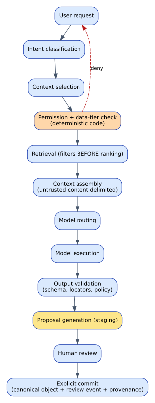
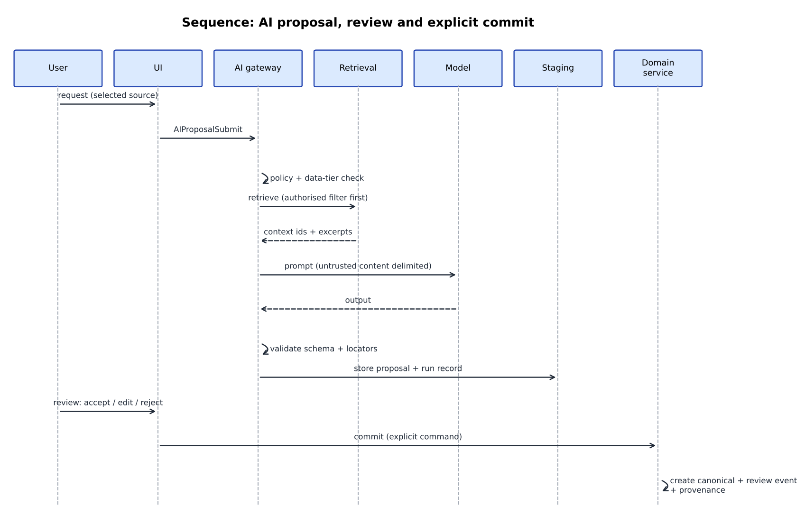

# 1. Purpose
Design AI as a separate, controlled subsystem: a fallible component that proposes, never a source of truth and never an uncontrolled writer of data @SD@ (05§1).

# 2. Scope
Gateway, model registry, prompt registry, retrieval/context assembly, proposal lifecycle, evaluation, prompt-injection defence, human review. Release scope: **v1.x for Personal (after v1.0)**; Investigative AI only under approved data tiers. No autonomous writes, no guilt/risk scoring, no causal simulation in the first AI release.

# 3. Dependencies
Doc 06 (ai_proposal, review_event, provenance), doc 10 (retrieval), doc 11; Research Pack 05 (all) @SD@; ADR-008, ADR-023, ADR-026; WP-044, WP-033.

# 4. Requirements
FR-AI-001, FR-AI-002 (P1), INT-005 (P0), SEC-010 (P1), T-AI-001…005. Source rules @SD@: model output is `synthetic_proposal` by default; an extraction candidate is not an observation until linked to a source locator and method; a human accepts/edits/rejects/defers; acceptance creates a review event; models may not determine wrongdoing, sanctions or legal status.

# 5. Design
## 5.1 Architecture
| Component | Responsibility |
|---|---|
| Model Gateway | Single entry; policy enforcement; routing; tracing |
| Provider adapters | Local on-device, user-controlled local service, private hosted, air-gapped, public cloud (tiers per @SD@ 05§6) |
| Model registry | Provider, model ID, quantisation, runtime, version, licence, evaluation, data tier, retention, known limitations @SD@ |
| Prompt registry | Versioned prompts, retrieval policies, extraction schemas, tool definitions |
| Context builder | Selects authorised items; records included/excluded items (token limits) |
| Retrieval layer | Lexical + graph + temporal filters (+ vector later) **filtering before ranking** |
| Token budgeting / caching | Budgets per request; cache only non-sensitive derived results, keyed by input hash + model/prompt version |
| Tracing / evaluation | Run provenance (no unnecessary prompt content), regression suite |
Default posture (ADR-023): **AI features off**; explicit consent per provider per contour; local model preferred for private Personal content; Investigative uses approved tiers by classification and case policy; **no cross-contour context ever**.

## 5.2 Processing pipeline

## 5.3 AI object lifecycle
Each AI run records: model, model version, prompt version, timestamp, input references, retrieved sources (IDs + locators), context metadata (included/excluded), processing parameters, output, validation result, review status, human decision @SD@. Stored as `activity (ai_run)` + `ai_proposal` (Appendix B). Proposal → **staging only**; `commit` is an explicit command that creates canonical objects with provenance and a `review_event`. Rejections leave canonical data untouched and are kept for evaluation. A reviewed claim retains both model and human provenance.

What AI may propose: entity/relation/claim extraction, summaries, hypotheses, contradictions, questions, timeline events. What it may not do: change authorization/scope, assign guilt, produce authoritative risk scores, run external actions, write verified facts.

## 5.4 Retrieval
Chunking by structure (paragraph/page/section) with stable source locators; metadata extraction; embeddings (ADR-008, Deferred) with model/version stored; lexical retrieval first; graph context via bounded neighbourhood; temporal filters; reranking only if measured; context assembly includes source identity, exact excerpts/locators, transformation history, relevant edges, contradictory evidence and explicit uncertainty @SD@. Retrieval is benchmarked separately from generation — a model cannot cite evidence it was never given @SD@.
**Personal vs Investigative:** separate retrieval implementations and policies. Investigative authorisation applies **before** snippets, counts, facets and autocomplete are formed @SD@.

## 5.5 Prompt injection and untrusted content
Documents, pages, emails, PDFs and OCR text are **data, not instructions** @SD@. Controls: delimit and label untrusted content; keep system/developer policy outside retrieved text; allow-listed tool schemas with scoped credentials; no tool selection by retrieved content; validate every proposed action in deterministic code; no credentials or unrelated user data in prompts; explicit approval for external side effects; test adversarial content in PDF metadata, OCR text, hidden HTML, markdown links, image alt text and embedded files @SD@. Output validation: schema, locator resolution against snapshots (quote must exist), policy checks.

## 5.6 Evaluation
| Capability | Metrics | Dataset |
|---|---|---|
| Entity / relation extraction | P/R/F1 by type; direction/type accuracy | Gold corpus per domain/language |
| Claim grounding | Source-span coverage; entailment review | Supported/unsupported/contradicted labels |
| Temporal extraction | Normalisation accuracy, interval error | Relative dates, time zones |
| Entity resolution | False merge/split rates | Adversarial near-duplicates |
| Retrieval | Recall@k, nDCG@k, latency | Keyword/vector/graph/hybrid ablation |
| Hallucination / citation | Unsupported claim rate; citation accuracy | Blind review |
| Contradiction detection | P/R | Labelled pairs |
| Calibration | Brier/reliability only if probabilities defined | Not used otherwise |
| Prompt injection | Attack success rate; privileged calls = 0 | Red-team corpus |
| Human review | Correction rate, time, disagreement, automation-bias indicators | Observed sessions |
Regression suite reruns on any model/prompt change; model-generated confidence is not a calibrated probability unless independently evaluated @SD@.

## 5.7 Human review
| Action | Review required |
|---|---|
| Accept/edit proposal into canonical object | Yes — always |
| Set claim assessment/review status | Human only |
| Merge/split entities | Yes, evidence recorded |
| Summaries shown in UI | Labelled AI-generated with sources; not stored as canonical |
| Any external action | Explicit approval |
Review UI shows source spans, model/prompt versions, validation result, and tracks review burden (not acceptance rate alone) @SD@ (01§8).

## 5.8 First AI release (recommended) @SD@ 05§12
Deterministic retrieval + source-linked extraction proposals: summarise a selected source; extract candidate entities/dates/claims with exact locators; identify possible contradictions; draft a comparison table. Not: autonomous verified facts, guilt assignment, authoritative risk scores, external actions, causal simulation.

## 5.9 Causality and scenarios (deferred)
A DAG encodes hypothesised structure, not causation; causal analysis requires estimand, assumptions, graph, confounders, identification strategy and sensitivity analysis; uncalibrated parameters forbid precise probabilities @SD@ (05§9). Not implemented before the data model and review workflows are stable.

# 6. Technology
Local inference runtimes, model formats and embedding models are **undecided** (hardware matrix and licence review needed). Provider SDKs are encapsulated in adapters; model files have checksums recorded in the registry; no vendor is endorsed here.

# 7. Implementation
1. Staging tables and review/commit commands without any model (WP-064 start) — testable with fake proposals. 2. Gateway + registries with a mock model. 3. Retrieval integration. 4. Local model adapter (opt-in). 5. Evaluation harness and gold sets (WP-065). 6. Injection red-team suite. 7. Review UI with metrics.

# 8. Data & Contracts
`AIProposalSubmit/Review` (App. C); `ai_proposal`, `activity`, `review_event` (App. B); registry schemas for models/prompts/tools (versioned).

# 9. Security
Data-tier policy enforced in code; consent records; no cross-contour/cross-case context (T-AI-005); telemetry/prompt logging minimised (record provenance, not full sensitive prompts, unless policy requires) @SD@; secrets never in prompts; model/provider egress allow-lists; output sanitised before rendering.

# 10. Failure Handling
Provider unavailable → feature off, canonical data unaffected; validation failure → proposal discarded with reason; policy denial → typed `POLICY_DENIED`; drift after model/prompt change → block deployment until regression passes; suspected injection → quarantine run and surface warning.

# 11. Testing
T-AI-001…005, T-EPI-001, T-SRCH-004 (retrieval ablation), human-review studies.

# 12. Acceptance Criteria
SG5 (AI): gold-set metrics recorded and accepted by owner; injection red-team results acceptable with zero privileged-tool invocations; review controls enforced; model registry complete; INT-005 test passes.

# 13. Deliverables
Gateway, registries, staging + commit workflow, review UI, evaluation harness, gold datasets, red-team corpus, governance document.

# 14. Risks
RK-07 automation bias; prompt injection; privacy leakage via cloud tiers; evaluation corpus cost; model drift.

# 15. Open Decisions
ADR-008, ADR-023 (confirm), local model choice, languages, consent UX, whether Investigative AI is offered at all (OQ-02/03).

# 16. References
Research Pack 05 §1–12 @SD@; OWASP Top 10 for LLM Applications (pack-cited, level 3).
