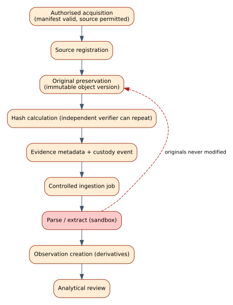

# 1. Purpose
Provide an independent engineering foundation for the Investigative Contour (governed analytical work with sources and evidence), **without** coupling it to Personal and **without** implying it ships in the first user release (doc 01 §5.2).

# 2. Scope
Backend architecture, tenant/case model, authorization, evidence registry and pipeline, ingestion sandbox, audit, retention, export. Not in scope: legal conclusions, certification, automatic attribution of guilt/intent, opaque risk scores @SD@.

# 3. Dependencies
Docs 03, 06, 11; POC-09/10; Research Pack 01§2.2, §4–5, 03§5–6, 04§8–11 @SD@. Open: OQ-02 (customer model), OQ-03 (jurisdictions), OQ-10 (audit/retention guarantees), ADR-003/009/020/021/022.

# 4. Requirements
> **Catalogue gap:** Detailed Investigative functional requirement rows are not included in this repository edition. The controls below describe proposed architecture, not an approved or implemented authorization/evidence system. Use the parent requirements in [Engineering Foundation](02_Engineering_Foundation.md) for orientation and restore the test-linked requirement catalogue before implementation planning.
Plus SEC-006/007/008/009, PRV-004, OPS-003/004 (doc 02 §4.4).

# 5. Design
## 5.1 Backend architecture
Separate deployment, identity context, tenant and case boundaries, database access, object storage, service identities, background processing and audit infrastructure (doc 03 §5.2–5.5; Figures 3.3, 3.5, 3.6). Modular monolith (NestJS-class framework is the *module container*, not the security boundary @SD@, ADR-013). Modules: Identity, Tenant, Case, Authorization, Evidence Registry, Ingestion Orchestrator, Parser Workers, Ontology & Graph, Audit, Review & Approval, Export/Dossier, AI Gateway.

## 5.2 Tenant and case model
| Entity | Description | Key fields |
|---|---|---|
| Organisation / Tenant | Isolation unit | id, name, policies, data residency (OQ-03) |
| User | Person with identity | id, tenant, authenticators, status |
| Role | Named permission bundle | analyst, supervisor, evidence_custodian, auditor, platform_admin, tenant_admin |
| Permission | Verb on resource class | e.g. `evidence.read_original` |
| Case | Authorised unit of work | id, tenant, status, manifest_id |
| Case Membership | User↔case↔role with validity | granted_by, valid_from/to |
| Authorization Manifest @SD@ | Authority type, issuing entity, jurisdiction, subject/scope, permitted sources, purpose, effective dates, expiry, approver | immutable versions; supersede to change |
| Purpose | Stated purpose limiting use | attached to manifest |
| Retention Policy | Retention period, legal hold, erasure rules | per case/tenant |
Source registry @SD@: permitted collection method, licensing/terms, rate limits, jurisdictional constraints per source.

## 5.3 Authentication and authorization
Authentication: phishing-resistant (passkeys/WebAuthn or IdP-provided equivalent; ADR-020 open), session hardening, **step-up** for export, role change, custody transfer, recovery @SD@. Authorization: deny-by-default; case-scoped; resource-level checks; service-to-service permissions via separate service identities; revocation takes effect immediately for new requests (cache invalidation via events); every decision auditable. Out-of-scope resources return uniform `NOT_FOUND`.

### Permission matrix (proposed @R@; A = allow, C = conditional, – = deny)
| Action | Analyst | Supervisor | Custodian | Auditor | Platform admin | Tenant admin |
|---|---|---|---|---|---|---|
| case.create | – | A (within authority) | – | – | – | C (if delegated) |
| case.read (assigned) | A | A | A | A (read-only) | – | – |
| manifest.approve/amend | – | A | – | – | – | – |
| role.grant/revoke | – | A (step-up) | – | – | – | C (tenant roles only) |
| evidence.ingest/seal | – | – | A | – | – | – |
| evidence.read_original | C (if permitted by manifest) | A | A | C (manifest/hash only) | – | – |
| evidence.transfer (custody) | – | C | A (step-up) | – | – | – |
| observation/claim.create | A | A | – | – | – | – |
| claim.review/approve | – | A (not own work) | – | – | – | – |
| search/read derivatives | A | A | A | C | – | – |
| export dossier | – | A (step-up) | C | – | – | – |
| audit.read | – | C (own cases) | – | A | – | – |
| infra operate / DB break-glass | – | – | – | – | C (audited, time-boxed, **no plaintext implied**) | – |
Positive examples: analyst assigned to case X creates observation in X (allowed, audited). Negative examples: analyst of case X reads case Y (denied, uniform not-found); supervisor approves own claim (denied); platform admin reads evidence content (denied); export without recent strong authentication (denied); ingestion after manifest expiry (denied); worker credential used against the API (denied). These form T-INV-002.

## 5.4 Evidence registry
| Object | Fields (summary) |
|---|---|
| Evidence Object | id, case, original_file_ref, source_id, status, verification_status |
| Original File | immutable object version in object store; byte length; hash |
| Acquisition Record | who, when, how, from where, environment, authority reference, limitations |
| Hash | algorithm + digest computed at ingest; re-verifiable independently |
| Custody Event | append-only: actor, time, action (acquire, seal, transfer, access, export), reason, object, prior state |
| Transformation / Extraction Record | tool+version, parameters, input/output refs, time |
| Verification Status | unverified / hash_verified / failed — with verifier identity |
Originals are never modified; corrections append events; derivatives are separate objects linked to originals @SD@.

## 5.5 Evidence pipeline

Each step writes an audit event; hash calculation can be repeated by an independent verifier.

## 5.6 Ontology, claims, hypotheses, review
Same canonical types as doc 06 with `tenant_id/case_id` and composite FKs. Claims require evidence links; reviewed status requires reviewer identity and review event; competing hypotheses stay separate; entity resolution is reversible with recorded evidence; no automated guilt; no single heuristic risk score @SD@.

## 5.7 Audit
| Element | Content |
|---|---|
| Event fields | who (actor, service identity), what (action), when (server time), where (client/service, network context), why (purpose/manifest/reason), which case, which resource, result, related evidence, correlation id |
| Coverage | **Reads, searches, exports and mutations of sensitive material** (not just writes) |
| Storage | Append-only table with insert-only role; hash chain; periodic **signed checkpoints** with separated key custody; optional RFC 3161 timestamps and external witnesses (ADR-009) |
| Verification | Independent verifier tool recomputes chain and checks signatures without the app |
| Limits | Not legal admissibility; logs are not an audit ledger @SD@ |
| Alerts | Anomalous export volume, repeated authorization failures, unusual case access, custody discontinuities |

## 5.8 Ingestion and sandbox
Authorized acquisition → registration → preservation → hash → metadata → controlled ingestion job → sandboxed parse/extract → observation creation → review. Parser workers: no credentials, no network egress, resource limits, read-only inputs, outputs validated against schemas before touching the registry; egress allow-listed and authorization-gated for any fetch step @SD@. Sandbox technique: ADR-021 (POC-10). Parsers are distinct from privileged services; worker identity cannot call the API.

## 5.9 Evidence export / dossier (Later)
Package: original evidence, hashes, acquisition metadata, custody history, transformation history, claims, source references, review records, limitations statement, export manifest, signatures/timestamps where applicable; standalone verifier. **No admissibility promise**; depends on jurisdiction, procedure and customer requirements (OQ-03/10) @SD@.

## 5.10 Retention, legal hold, erasure
Policy per case/tenant; legal hold overrides deletion; erasure requests handled by workflow with documented conflicts (GDPR-style principles: purpose limitation, minimisation, storage limitation @SD@, jurisdiction-specific review needed); non-pertinent third-party PII separation and minimisation actions recorded.

# 6. Technology
PostgreSQL (ADR-003) with forced RLS and constrained roles (doc 06 DDL; Appendix F §4); object storage with versioning/retention (provider TBD); queue; KMS; sandbox technique (ADR-021); IdP/passkeys (ADR-020); Drizzle is a candidate typed access layer only @SD@.

# 7. Implementation
1. Separate backend skeleton and isolation proof (WP-070). 2. Tenant/case/manifest/authorization/review/retention (WP-071) with permission matrix as executable tests. 3. Evidence registry + custody (WP-072). 4. Ingestion + sandbox (WP-073). 5. Audit + verifier (WP-074). 6. Security suite (WP-075). 7. Later: dossier export, entity resolution, case analysis (WP-076).

# 8. Data & Contracts
Appendix B (shared canonical types), Appendix C (case, custody, ingest, review, export operations), audit event schema above, manifest schema (versioned JSON Schema).

# 9. Security
Threat matrix Appendix D (Investigative section); RLS owner/bypass handling; metadata authorisation; separation of duties; least-privilege service identities; hostile-file handling; key custody separation for checkpoint signing; admin ≠ plaintext.

# 10. Failure Handling
Manifest expiry mid-ingest → job stops, audit event; hash mismatch → evidence flagged, custody inconsistency alert; DB failover → read-only until healthy; audit-sink failure → privileged actions blocked (fail closed) or queued with durable local audit buffer (decision at SG6, @OD@); object store outage → ingestion paused; parser failure → job fails closed; restore → re-verify hashes and audit chain.

# 11. Testing
T-INV-001…007, T-EVD-001…003, T-ING-001…004, T-AUD-001/002, T-SEC-010/011, T-SRCH-005, T-ISO-001…003, T-OPS-003/004, T-EXP-001/002.

# 12. Acceptance Criteria
SG6: isolation, authorization, custody, audit and sandbox tests green in staging; independent verifier validates evidence integrity and audit chain; restore drill passes; legal/jurisdiction scope recorded for any customer-facing use.

# 13. Deliverables
Backend modules, schemas/migrations with forced RLS, permission-matrix test suite, verifier tool, sandbox images, runbooks, threat model sign-off.

# 14. Risks
RK-02, RK-08, RK-09, RK-10, RK-16, RK-18; enterprise feature creep before customer model is known.

# 15. Open Decisions
OQ-02, OQ-03, OQ-10; ADR-009, ADR-020, ADR-021, ADR-022; audit-sink failure policy; hash algorithm and signing keys custody; analyst original-read policy defaults.

# 16. References
Research Pack 01§2.2, §4–5; 03§5–6, §11; 04§8–12 @SD@; refs X4, X14–X16, X19.
