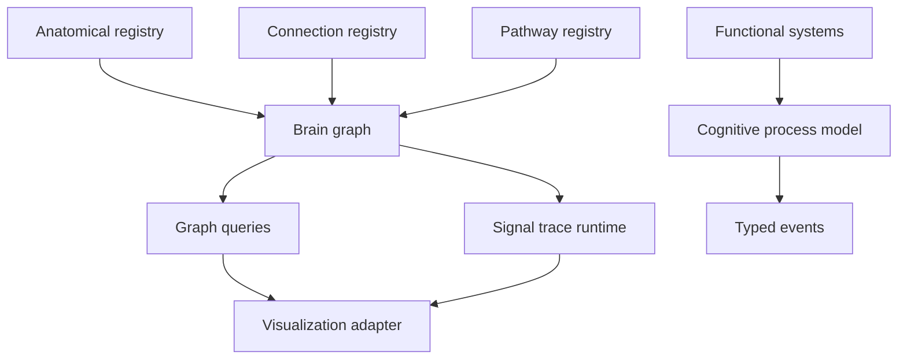

# Architecture

## Package responsibility

`@repo/brain` is a domain-model package. It owns a stable vocabulary for anatomical structures, connections, functional groupings, pathways, cognitive-process descriptions, and event contracts.

It does not own application state, user content, persistence, authorization, AI orchestration, or UI components.

## Conceptual layers

## Source-of-truth strategy

Registries are immutable runtime data (`as const`). Public identifier types are derived from registry keys. This avoids trying to inspect erased TypeScript interfaces at runtime and ensures that graph references can be statically checked.

The package deliberately separates:
- **Anatomical hierarchy:** parent-child containment (for example, brain → telencephalon → cerebral cortex).
- **Connectivity:** edges between structures, which are not containment relationships.
- **Functional membership:** a structure may participate in multiple functional systems.
- **Cognitive process descriptions:** distributed processes associated with candidate regions.
- **Runtime traces:** graph traversal over selected edges, not neural physiology.

## Dependency policy

The package has no runtime dependencies. It must not import application, database, API, UI, AI, or storage packages. Consumers depend on `@repo/brain`, never the reverse.

## Suggested future package boundaries

Do not split prematurely. If the model grows, consider:
- `@repo/brain-data-*` for separately versioned source datasets;
- `@repo/brain-sim` for validated numerical simulation;
- `@repo/brain-viz` for interactive rendering.

Keep `@repo/brain` as the canonical domain contract unless independent release cycles become necessary.
